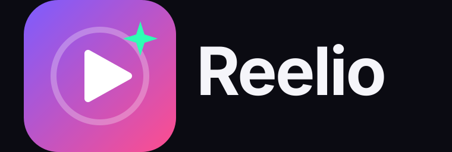

<b>Une idée. Cinq réseaux.</b>

Reelio est un agent IA qui produit et publie du contenu social à partir d'une simple idée :

- textes de publication et hashtags adaptés à chaque réseau ;
- vidéos reels verticales ;
- publication ou programmation sur **Facebook, Instagram, X, YouTube et TikTok**.

> Statut : conception. Usage personnel d'abord, commercialisation envisagée plus tard.

## Feuille de route
1. [x] Nom, logo et identité visuelle
2. [ ] Architecture de l'agent (planification, génération, publication)
3. [ ] Génération de textes et hashtags par réseau
4. [ ] Génération de reels vidéo
5. [ ] Connexion aux API officielles des réseaux
6. [ ] Validation humaine avant publication
7. [ ] Interface web sombre

Voir le [guide de marque](brand/BRAND.md).
